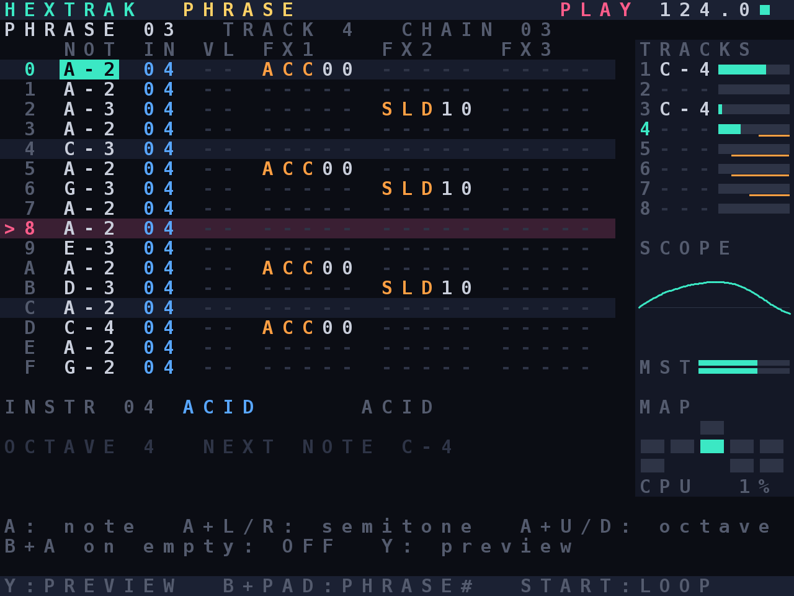
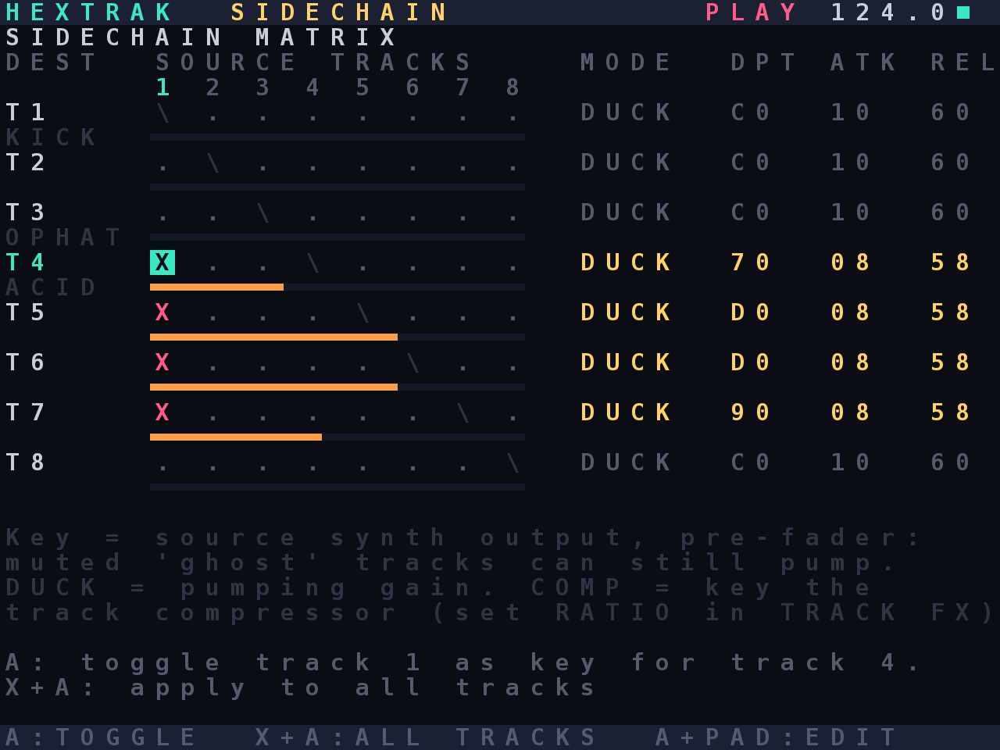

# Hextrak

A gamepad-driven music tracker for Android, laid out for the **Anbernic RG477M**
(4.7" 4:3, 1280×960, Android 14). It takes after LSDJ, LittleGPTracker, M8 and Polyend Tracker:
a song → chain → phrase workflow, hex values, and every function on the built-in controls.



The UI is a 40×30 character grid. On the RG477M's 1280×960 panel each cell is exactly
32×32 px. On other screens it scales to the largest whole-pixel size and is centred.

## Install

```bash
adb install -r Hextrak-1.0.apk
```

You can also copy the APK to the device and open it with a file manager. It needs no permissions.
On first launch a demo song loads. Your work autosaves whenever the app is paused or closed.

## Sound

**Synth engines** (one per instrument, 128 instruments):

| Engine | What it is |
|---|---|
| FM4   | 4-operator FM, 8 algorithms, op-4 feedback, per-op ratio and ADSR, velocity → brightness |
| ACID  | 303-style mono bass: saw/square, resonant 24 dB ladder filter, env-mod, decay, accent with "wow", slide, drive |
| DRUM  | Percussion synth with 11 models: kick, snare, closed hat, open hat (choked by the next hit), clap, tom/conga, rim, cowbell, cymbal, shaker, zap |
| VA    | Virtual analog: 2 oscillators + sub, 1–4 voice unison with stereo spread, LP12/LP24/BP/HP filter, 2 ADSRs, LFO, glide, drive |
| WAVE  | Wavetable with 8 morphing band-limited tables (basic, PWM, vocal, digital, organ, sync, bell, fold), mod envelope, LFO, filter |
| PLUCK | Karplus-Strong string: damping, pluck position, exciter colour, body resonance |
| CHIP  | Game-console style voice: 4 pulse widths, 4-bit triangle and saw, long and short (metallic) noise, pitch sweep, vibrato |

There are 46 presets across the engines (A+L/R on PRESET, then A to load).

**Per-track channel strip** (8 tracks): insert effect (drive, bitcrush, chorus, phaser, flanger,
filter, tremolo/autopan, ring mod) → 3-band EQ → compressor → sidechain ducker → stereo width →
volume/pan → look-ahead limiter → delay and reverb sends.

**Send effects and master bus:** tempo-synced ping-pong delay that can feed the reverb, a reverb,
master EQ, glue compressor, limiter and volume.

**Sidechain:** the SIDECHAIN screen is an 8×8 matrix. Rows are destination tracks and columns are
source tracks. Press **A** on a cell to let that source duck the track. **X+A** on a column makes
that source duck every track at once. Each destination has its own mode:
- **DUCK**: pumping gain with depth, attack and release.
- **COMP**: the sources become the key for that track's compressor.

The key is the source's raw synth output, taken before the fader. A muted "ghost" kick track can
still drive the pumping.



## Controls

| Input | Action |
|---|---|
| D-pad / left stick | Move cursor |
| A | Insert value / run action |
| A + D-pad | Edit value (left/right = fine, up/down = coarse, octave on notes) |
| A, A (double tap on empty cell) | New unused chain / phrase / instrument |
| B + A | Delete cell (on an empty note cell: note OFF) |
| X + A | Clone chain / phrase / instrument to a new number |
| B + D-pad | Browse chain / phrase / instrument numbers |
| SELECT + D-pad | Change screen |
| SELECT + B | Start selection (D-pad resizes). Then **A** copies, **B** cuts |
| SELECT + A | Paste |
| START | Play/stop. Loops the current chain/phrase on those screens; plays the song elsewhere |
| SELECT + START | Play the song from the song cursor row |
| Y (hold) | Preview the note or instrument |
| L1 / R1 | Previous / next track |
| L2 / R2 | Page up / down |
| Right stick | Edit the value under the cursor |
| SELECT + Y | Help |
| BACK (twice) | Save and quit |

If your face buttons are labelled the other way round, use **PROJECT → SWAP AB / SWAP XY**.

**Screen map:**
```
                 PROJECT
SONG  CHAIN  PHRASE  INSTRUMENT  TRACK FX
   MIXER        EFFECTS          SIDECHAIN
```

## Phrase FX commands (3 columns per step, 6 ticks per step)

`ARP xy` arpeggio · `SLD xx` slide/legato · `ACC` accent · `PUP/PDN xx` pitch slide ·
`VIB xy` vibrato · `RTG xx` retrigger · `KIL xx` cut · `DLY xx` delay note · `CHA xx` probability ·
`CUT/RES xx` filter override · `PAN xx` · `TMP xx` tempo · `DSN/RSN xx` send levels ·
`TIM xx` timbre macro · `VSL xy` volume slide · `HOP xx` jump to step

## Files

- Projects: `Android/data/com.hextrak.app/files/projects/*.htk` (plain text)
- WAV renders (PROJECT → RENDER): `Music/Hextrak/NAME.wav`, 16-bit stereo at the device sample rate

## Build

Requirements: JDK 17+, Android SDK 35, NDK 27.2.12479018, CMake 3.22.1.

```bash
echo "sdk.dir=/path/to/android-sdk" > local.properties
./gradlew :app:assembleRelease      # app/build/outputs/apk/release/app-release.apk
```

The release build is signed with the debug key so it can be side-loaded. Use your own key for distribution.

Host tests run the real native engine on the JVM. They render the demo and every preset to WAV,
check input flows and save/load, and write PNG screenshots of every screen to `build/host/`:

```bash
tools/build_host_native.sh && ./gradlew :core:test
```

## Layout

```
app/src/main/cpp/        native engine (C++17, AAudio): sequencer, voices, effects, mixer
  params.h               parameter layout shared with Kotlin (core/.../Defs.kt)
  engine.cpp             sequencer + channel strips + master bus + WAV render
  voice.cpp              the 7 synth engines
  fx.h                   inserts, EQ, compressor, ducker, limiter, delay, reverb
app/src/main/java/       Android activity, gamepad mapping, grid renderer, storage
core/src/main/kotlin/    platform-independent tracker: model, screens, input, presets, demo
```
